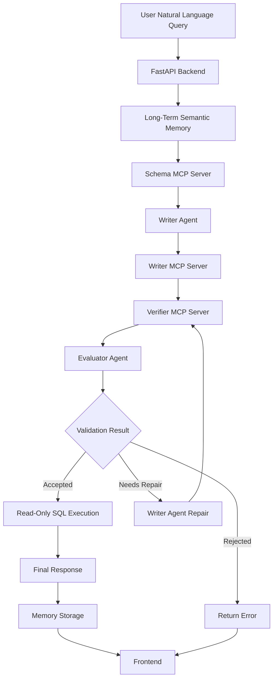

# VeriSQL – Multi-Agent Text-to-SQL System

An MCP-powered multi-agent Text-to-SQL application that converts natural-language questions into SQL queries, independently verifies generated queries, automatically repairs incorrect SQL, and executes approved queries against relational databases.

---

## Project Overview

VeriSQL is designed to simplify database interaction by allowing users to query relational databases using natural language instead of writing SQL manually.

The system uses specialised AI agents and Model Context Protocol (MCP) servers to retrieve database schemas, generate SQL queries, validate query safety, identify errors and perform automated repairs.

It also incorporates long-term semantic memory to retrieve relevant previous query experiences and provide additional context during SQL generation.

**Current Status:** The complete agentic workflow, FastAPI backend and interactive frontend are working locally. AWS Blue-Green deployment is currently under development.

## System Architecture



## Key Features

### 1. Schema MCP Server

Responsible for retrieving database metadata and providing schema context to the agents.

- Lists permitted databases.
- Retrieves table and column definitions.
- Identifies primary-key and foreign-key relationships.
- Retrieves controlled sample values.
- Finds relevant columns based on natural-language questions.
- Uses database allowlisting and controlled metadata access.

### 2. Writer Agent

Converts natural-language questions into SQL queries.

- Uses Groq with GPT-OSS-20B.
- Retrieves schema context before generating SQL.
- Uses LangChain for prompt construction and model interaction.
- Uses Pydantic for structured outputs.
- Uses SQLGlot for SQL parsing and validation.
- Generates SQL explanations.
- Supports automatic SQL repair using evaluator feedback.

### 3. Writer MCP Server

Exposes SQL generation and repair capabilities through MCP tools.

**Tools:**

- `generate_sql` – Generates SQL from a natural-language question and schema context.
- `repair_sql` – Corrects previously generated SQL using evaluator feedback.

### 4. Verifier MCP Server

Independently validates generated SQL before execution.

**Verification capabilities:**

- SQL syntax validation.
- SQL safety validation.
- Database schema validation.
- Read-only query execution.
- Sensitive-column restrictions.
- Result-row limits.

The Verifier MCP acts as an independent validation layer rather than trusting the Writer Agent's output.

### 5. Evaluator Agent

Evaluates whether generated SQL is valid and correctly answers the original question.

- Combines deterministic validation with semantic evaluation.
- Checks syntax, safety, schema compatibility and execution.
- Evaluates semantic correctness.
- Identifies incorrect joins, invalid columns and incorrect filters.
- Generates actionable feedback.
- Routes incorrect but repairable queries back to the Writer Agent.
- Supports a bounded repair loop of up to three attempts.

### 6. Long-Term Semantic Memory

VeriSQL uses persistent semantic memory to reuse relevant previous query experiences across sessions.

**Implementation:**

- SQLite-based persistent memory storage.
- Sentence Transformers for embedding generation.
- Embedding model: `sentence-transformers/all-MiniLM-L6-v2`.
- Embedding dimension: 384.
- Cosine similarity for retrieving relevant experiences.
- Stores previous questions, SQL queries, evaluation outcomes and feedback.
- Prioritises useful accepted experiences while retaining failed-query warnings.

Retrieved memories are used as additional context, not as trusted SQL instructions. Every newly generated query must undergo fresh verification.

### 7. LangGraph Orchestration

LangGraph coordinates the multi-agent workflow through state management and conditional routing.

**Workflow components:**

1. Memory retrieval.
2. SQL generation.
3. SQL evaluation.
4. Conditional routing.
5. SQL repair when required.
6. Final response generation.
7. Long-term memory storage.

The repair node routes back to evaluation so that every repaired query is checked again.

### 8. Interactive Web Application

The frontend provides an interface for interacting with VeriSQL.

Features include:

- Natural-language query workspace.
- Database connection management.
- Schema exploration.
- Generated SQL display.
- Agent workflow visibility.
- Query execution results.
- CSV export.
- Query history and memory information.

The frontend is built using HTML, CSS and JavaScript and communicates with the FastAPI backend.

---

## Security Architecture and Guardrails

Security is a core part of VeriSQL. Since LLM-generated SQL can contain incorrect, destructive or potentially sensitive operations, the system implements multiple layers of validation and database-level restrictions.

### 1. Database Access Guardrails

- Database allowlisting to restrict access to permitted databases.
- Controlled database connection handling.
- Read-only SQLite connections for query execution.
- SQLite `PRAGMA query_only = ON` to prevent database modifications.
- Restricted access to database metadata and sample values.

### 2. SQL Syntax and Statement Guardrails

SQLGlot is used to parse generated SQL and inspect its structure.

Implemented checks include:

- SQL syntax validation.
- Single-statement validation.
- SQL statement-type validation.
- Rejection of destructive and data-modifying operations.

Operations restricted by the verifier include:

- `INSERT`
- `UPDATE`
- `DELETE`
- `DROP`
- `ALTER`
- `CREATE`

### 3. Sensitive Data Protection

- Sensitive-column detection.
- Restrictions on retrieving sensitive sample values.
- Validation of referenced tables and columns against the actual schema.
- Restrictions on accessing sensitive fields such as email addresses.

### 4. Query Execution Guardrails

- Read-only SQL execution.
- Maximum result-row limits.
- Schema validation before execution.
- Independent verification before returning query results.
- Database-level restrictions complementing application-level SQL validation.

### 5. Agent-Level Guardrails

- The Writer Agent generates SQL but does not independently approve its output.
- The Evaluator checks generated SQL using deterministic and semantic validation.
- Unsafe queries are rejected rather than sent through the automatic repair loop.
- SQL repair is limited to a maximum of three attempts.
- Every repaired query must undergo fresh verification.

### 6. Long-Term Memory Safety

- Retrieved memories are used only as contextual assistance.
- Previous SQL queries are not treated as trusted or automatically executable instructions.
- Memory does not bypass current schema or security validation.
- Every new query must pass the current verification process.

**Known Security Limitation:** The current development implementation has a known limitation involving wildcard projections such as `SELECT *`, which may expose restricted columns if sensitive-column checks do not expand wildcard selections against the database schema. Strengthening wildcard handling and column-level access control is part of the planned security improvements.

**Security principle:** Never trust LLM-generated SQL directly. Every query must pass independent validation and controlled execution before its results are returned.

---

## Technology Stack

| Category | Technologies |
|---|---|
| Programming Language | Python |
| Backend | FastAPI |
| AI Model Provider | Groq |
| Model | GPT-OSS-20B |
| Agent Framework | LangChain |
| Workflow Orchestration | LangGraph |
| Agent Communication | Model Context Protocol (MCP) |
| SQL Parsing | SQLGlot |
| Structured Validation | Pydantic |
| Embeddings | Sentence Transformers |
| Embedding Model | all-MiniLM-L6-v2 |
| Database | SQLite, PostgreSQL, MySQL |
| Memory Storage | SQLite |
| Frontend | HTML, CSS, JavaScript |
| Version Control | Git, GitHub |
| Cloud Deployment | AWS – Blue-Green Deployment (In Progress) |

---

## Project Structure

```text
VeriSQL/
│
├── agents/
│   ├── writer.py
│   └── evaluator.py
│
├── mcp_servers/
│   ├── schema/
│   │   └── server.py
│   ├── writer/
│   │   └── server.py
│   └── verifier/
│       └── server.py
│
├── frontend/
│   └── index.html
│
├── data/
│   └── Demo databases and test data
│
├── notebooks/
│   ├── 01_schema_mcp.ipynb
│   ├── 02_writer_agent_mcp.ipynb
│   ├── 03_evaluator_agent_mcp.ipynb
│   └── 04_long_term_memory_langgraph_integration.ipynb
│
├── app.py
├── requirements.txt
├── .env.example
├── .gitignore
└── README.md
```

---

## Local Setup and Execution

### 1. Clone the Repository

```bash
git clone https://github.com/YOUR_USERNAME/VeriSQL-Multi-Agent-Text-to-SQL.git

cd VeriSQL-Multi-Agent-Text-to-SQL
```

### 2. Create a Virtual Environment

```bash
python -m venv venv
```

Activate it:

**Windows**

```bash
venv\Scripts\activate
```

**Linux / macOS**

```bash
source venv/bin/activate
```

### 3. Install Dependencies

```bash
pip install -r requirements.txt
```

### 4. Configure Environment Variables

Create a `.env` file in the project root.

Add the required credentials:

```env
GROQ_API_KEY=your_groq_api_key
```

Add any other environment variables required by your configuration.

Never commit your actual `.env` file or API keys to GitHub.

### 5. Start the FastAPI Application

```bash
uvicorn app:app --reload
```

### 6. Access the Application

| Service | URL |
|---|---|
| VeriSQL Web Application | http://127.0.0.1:8000/ |
| FastAPI Swagger Documentation | http://127.0.0.1:8000/docs |
| Backend Health Check | http://127.0.0.1:8000/api/health |

The application is currently functional in the local development environment.

---

## API Endpoints

| Method | Endpoint | Description |
|---|---|---|
| POST | `/api/database/connect` | Connect to a database |
| POST | `/api/database/disconnect` | Disconnect the database |
| GET | `/api/database/status` | Retrieve connection status |
| GET | `/api/database/schema` | Retrieve database schema |
| POST | `/api/query` | Submit a natural-language SQL query |
| GET | `/api/history` | Retrieve query history |
| GET | `/api/health` | Check backend health |
| GET | `/` | Serve the frontend |

---

## Engineering and Implementation

### Schema Intelligence and MCP Integration

- Developed Schema MCP for database discovery and schema retrieval.
- Implemented table, column and relationship identification.
- Added relevant-column retrieval and controlled sample-value access.
- Implemented database allowlisting and metadata access restrictions.

### Multi-Agent SQL Generation and Verification

- Developed the Writer Agent for natural-language-to-SQL generation.
- Integrated Groq, LangChain and Pydantic structured outputs.
- Implemented SQLGlot-based parsing and validation.
- Developed the Verifier MCP for independent syntax, safety, schema and execution checks.
- Implemented the Evaluator Agent for semantic assessment and actionable feedback.
- Built an automated SQL repair loop with a maximum of three attempts.
- Added evaluation and repair logging.

### Long-Term Memory and Workflow Orchestration

- Implemented persistent semantic memory using SQLite.
- Integrated Sentence Transformers with all-MiniLM-L6-v2 embeddings.
- Implemented cosine similarity-based memory retrieval.
- Added accepted and failed experience filtering.
- Integrated retrieved memory context into SQL generation.
- Developed LangGraph-based workflow orchestration.
- Connected memory retrieval, generation, evaluation, conditional repair, final response generation and memory storage.

### Backend, Frontend and Application Integration

- Developed the FastAPI backend.
- Integrated the MCP servers and AI agents into the application workflow.
- Built the interactive frontend using HTML, CSS and JavaScript.
- Implemented database connection management, schema exploration, query execution and result presentation.
- Integrated query history and long-term memory functionality.

---

## Evaluation and Testing

The initial development benchmark contains eight test cases covering:

- Basic SQL generation.
- Salary filtering.
- Missing JOIN detection.
- Aggregation queries.
- Invalid column detection.
- Incorrect JOIN and column references.
- Incorrect filter conditions.
- Sensitive-column access.

### Recorded Development Results

| Metric | Result |
|---|---:|
| Total test cases | 8 |
| Completed workflows | 8 |
| Accepted workflows | 7 |
| Rejected workflows | 1 |
| Acceptance rate | 87.5% |
| Repair attempts | 4 |
| Successful repairs | 4 |
| Repair success rate | 100% |

These are preliminary results from a small development benchmark, not generalised accuracy measurements.

### Web Application Testing

The local web application has also been tested with a multi-table JOIN query involving:

- `employees`
- `employee_projects`
- `projects`

The application successfully generated, verified and executed the query, returning 10 rows in the observed test.

---

## Deployment Roadmap

### Current Status – Local Development

The complete agentic application workflow has been developed by **Akula Monish Ram** and is working locally.

Completed development includes:

- Three MCP servers: Schema, Writer and Verifier.
- Writer Agent and Evaluator Agent.
- SQL generation, verification and automated repair.
- Security guardrails and read-only execution.
- Long-term semantic memory.
- LangGraph multi-agent orchestration.
- FastAPI backend.
- Interactive frontend.
- Initial functional testing and evaluation.

### In Progress – AWS Blue-Green Deployment

**Deployment Lead: Raghava Sai**

Raghava Sai is currently working on the AWS deployment architecture and implementation of Blue-Green deployment for VeriSQL.

The planned deployment approach includes:

**Blue Environment**
- Represents the currently stable application version.
- Continues serving traffic while a new release is prepared.

**Green Environment**
- Hosts the new application version.
- Is deployed and tested independently before receiving production traffic.

**Traffic Switching**
- Routes application traffic to the Green environment after successful validation.

**Rollback**
- Enables switching back to the Blue environment if the new deployment encounters issues.

The objective is to support safer application releases, minimise deployment downtime and enable controlled version transitions.

**Deployment Status:** AWS deployment is in progress. Production deployment, traffic switching and rollback are not yet claimed as completed.

---

## Future Improvements

- Complete AWS Blue-Green deployment.
- Strengthen wildcard SQL and column-level security.
- Expand benchmark coverage with more complex SQL queries.
- Improve memory retrieval and database isolation.
- Implement stronger authentication and multi-user access controls.
- Improve monitoring and deployment reliability.
- Conduct broader end-to-end testing across supported databases.

---

## Project Contributors and Responsibilities

### Akula Monish Ram

**Role: Backend Developer | AI/ML Engineer**

Responsible for developing the complete backend and agentic AI workflow of VeriSQL.

**Key Contributions:**
- Designed and developed all three MCP servers: Schema, Writer and Verifier.
- Developed the Writer Agent and Evaluator Agent.
- Implemented natural-language-to-SQL generation.
- Developed SQL verification, validation and automated repair mechanisms.
- Implemented SQL security guardrails and read-only query execution.
- Designed and integrated long-term semantic memory using Sentence Transformers.
- Implemented LangGraph-based multi-agent orchestration.
- Developed the FastAPI backend.
- Integrated agents, MCP servers, database operations and memory into the backend application.
- Conducted backend testing and benchmark evaluation.

GitHub: [Monish-Ram250](https://github.com/Monish-Ram250)

### Raghava Sai

**Role: Frontend Developer | AWS Cloud Deployment**

Responsible for developing the frontend interface and working on the cloud deployment of VeriSQL.

**Key Contributions:**
- Developing the interactive frontend using HTML, CSS and JavaScript.
- Working on frontend integration with the FastAPI backend.
- Implementing the user interface for database connections, natural-language queries, generated SQL and query results.
- Working on AWS cloud deployment.
- Implementing the Blue-Green deployment strategy.
- Working on deployment environments, traffic management and rollback mechanisms.

### Collaboration

Monish is responsible for the complete backend development, including the MCP servers, AI agents, SQL generation and verification, long-term memory, LangGraph orchestration and FastAPI integration.

Raghava Sai is responsible for frontend development and is working on AWS cloud deployment and Blue-Green deployment implementation.

## Demo Video Link : https://drive.google.com/file/d/1jqj-IlgAA30fljfZ_gmnqbEXKs4JbMOz/view?usp=sharing

Together, we are building VeriSQL as a complete multi-agent Text-to-SQL application with an interactive frontend and cloud deployment.

---

**VeriSQL – Making Natural Language Database Interaction Safer Through Multi-Agent Intelligence.**
